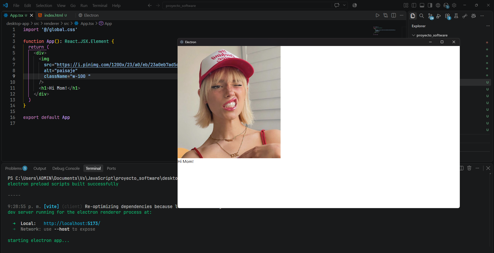

# Proyecto de software

Este repositorio contiene dos proyectos:

- **`api-server`**: API desarrollada con Python y FastAPI para consultar
  información de los procesos que se están ejecutando en el equipo.
- **`desktop-app`**: aplicación de escritorio desarrollada con Electron, React
  y TypeScript. Actualmente es una base inicial con las dependencias y la
  estructura principal configuradas; todavía no está conectada a la API ni
  implementa la interfaz funcional del producto.

## Estructura

```text
api-server/   API FastAPI y lógica para consultar procesos
desktop-app/  Aplicación de escritorio Electron y React
```

## API (`api-server`)

### Requisitos

- Windows. El servidor utiliza `pywin32` para leer la descripción de los
  archivos de los procesos.
- [Python](https://www.python.org/downloads/) 3.12 o posterior.
- [uv](https://docs.astral.sh/uv/getting-started/installation/) para gestionar
  el entorno virtual y las dependencias.

Comprueba que las herramientas están disponibles:

```powershell
python --version
uv --version
```

### Instalación y ejecución

Desde la raíz del repositorio:

```powershell
cd api-server
uv sync
uv run uvicorn api_server.main:app --reload
```

El servidor estará disponible en <http://127.0.0.1:8000>. La opción `--reload`
lo reinicia cuando detecta cambios; puedes quitarla para ejecutarlo sin recarga
automática. Las dependencias están definidas en
[`api-server/pyproject.toml`](api-server/pyproject.toml) y sus versiones
resueltas en `api-server/uv.lock`.

FastAPI genera documentación interactiva automáticamente:

- Swagger UI: <http://127.0.0.1:8000/docs>
- ReDoc: <http://127.0.0.1:8000/redoc>

### Endpoints

| Método | Ruta        | Descripción                               |
| ------ | ----------- | ----------------------------------------- |
| `GET`  | `/`         | Devuelve el mensaje `Hi Mom!`.            |
| `GET`  | `/process/` | Devuelve información de procesos activos. |

El endpoint de procesos acepta el parámetro opcional `limit`, que determina el
número máximo de procesos a devolver. Su valor predeterminado es `10` y acepta
valores entre `1` y `500`.

La respuesta tiene esta estructura:

```json
{
  "total": 1,
  "processList": [
    {
      "pid": 123,
      "nombre": "nombre-del-proceso",
      "descripcion": "Descripción del proceso",
      "usuario": "usuario",
      "cpu": 0,
      "memoria_mb": 0,
      "prioridad": "Unknown"
    }
  ]
}
```

Los valores dependen de los procesos activos en el equipo. `total` indica
cuántos elementos se han incluido en `processList`, no necesariamente el total
de procesos del sistema. La descripción se obtiene de los metadatos del archivo
cuando están disponibles; en caso contrario, se genera una descripción
predeterminada.

## Aplicación de escritorio (`desktop-app`)

### Tecnologías y estado actual

El frontend de escritorio está construido con:

- [Electron](https://www.electronjs.org/) y
  [electron-vite](https://electron-vite.org/) para la aplicación y su flujo de
  desarrollo.
- [React](https://react.dev/) y TypeScript para la interfaz.
- [Tailwind CSS](https://tailwindcss.com/) para estilos.
- [lucide-react](https://lucide.dev/) para iconos.

La aplicación incluye los procesos principales de Electron (`main`, `preload` y
`renderer`) y una pantalla de ejemplo. Las dependencias actuales son las bases
del proyecto; la integración con la API, las pantallas del producto y sus
flujos todavía están pendientes.

#### Vista actual



### Requisitos

- [Bun](https://bun.sh/) para instalar las dependencias usando el archivo
  `bun.lock`.

Electron incluye su propio runtime de Node.js, así que no hace falta instalar
Node.js por separado para ejecutar los comandos documentados aquí. Comprueba que
Bun está disponible:

```powershell
bun --version
```

### Instalación y modo desarrollo

Desde la raíz del repositorio:

```powershell
cd desktop-app
bun install
bun run dev
```

`bun run dev` inicia la aplicación de escritorio con recarga de desarrollo.
Para volver a iniciarla después, ejecuta el comando desde la carpeta
`desktop-app`.

### Comprobaciones y compilación

Los scripts disponibles permiten comprobar los tipos y generar la compilación:

```powershell
bun run typecheck
bun run build
```

`build` ejecuta primero la comprobación de TypeScript y luego compila la
aplicación. También hay comandos de empaquetado en
`desktop-app/package.json`, como `build:win`, `build:mac` y `build:linux`.

### Alias de importación

En el renderer se puede importar desde `src/renderer/src` usando el alias `@/`.
Por ejemplo:

```tsx
import MiComponente from "@/components/MiComponente";
```
