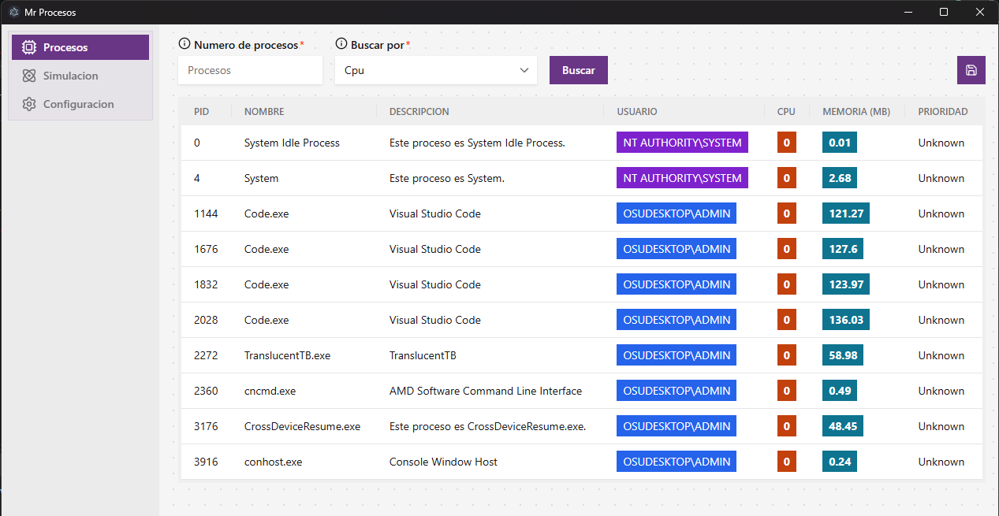
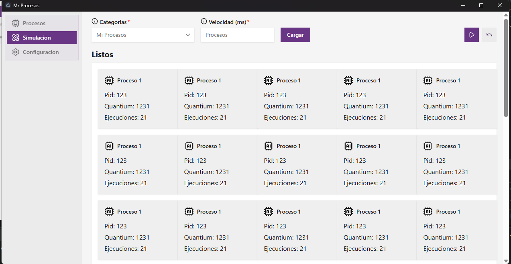

# Proyecto de software

Este repositorio contiene dos proyectos:

- **`api-server`**: API desarrollada con Python y FastAPI que consulta procesos
  activos y devuelve datos como PID, nombre, descripción, usuario, CPU y memoria.
  Persiste los catálogos de procesos en SQLite mediante SQLAlchemy.
- **`desktop-app`**: aplicación de escritorio desarrollada con Electron, React
  y TypeScript. Incluye vistas para procesos y una simulación visual de procesos.
  La interfaz todavía no está conectada a la API; utiliza datos de ejemplo.

## Estructura

```text
api-server/   API FastAPI y lógica para consultar procesos
desktop-app/  Aplicación de escritorio Electron y React
```

## API (`api-server`)

Consulta procesos del sistema operativo y permite guardar y administrar catálogos
de procesos en SQLite. La documentación completa —endpoints, DTOs, formas del
JSON, errores y esquema de la base de datos— está en
[`api-server/README.md`](api-server/README.md).

Para levantarla:

```powershell
cd api-server
uv sync
uv run uvicorn api_server.main:app --reload
```

El servidor estará disponible en <http://127.0.0.1:8000>, con documentación
interactiva en <http://127.0.0.1:8000/docs>.

Ejecuta la consola **como administrador** para que la API pueda leer también los
procesos propiedad de otras cuentas, como los servicios del sistema. Sin
privilegios, `GET /process/` los descarta.

## Aplicación de escritorio (`desktop-app`)

### Tecnologías y estado actual

El frontend de escritorio está construido con:

- [Electron](https://www.electronjs.org/) y
  [electron-vite](https://electron-vite.org/) para la aplicación y su flujo de
  desarrollo.
- [React](https://react.dev/) y TypeScript para la interfaz.
- [HeroUI](https://www.heroui.com/) (`@heroui/react` y `@heroui/styles`) para
  los componentes de interfaz.
- [Tailwind CSS](https://tailwindcss.com/) para personalizar los componentes
  con clases de utilidad.
- [lucide-react](https://lucide.dev/) para iconos.

HeroUI proporciona los componentes de interfaz —pestañas, campos de entrada,
selectores, botones, tooltips, tablas y modales—. Sus estilos base se cargan
desde `@heroui/styles` en `global.css`, y Tailwind CSS se utiliza para adaptar
la distribución y apariencia.

La aplicación incluye los procesos principales de Electron (`main`, `preload`
y `renderer`) y tres secciones de navegación:

- **Procesos**: vista tabular con PID, nombre, descripción, usuario, CPU,
  memoria y prioridad; incluye controles de búsqueda y guardado como parte del
  prototipo.
- **Simulación**: esquema visual con procesos en las colas de listos,
  ejecución, espera y terminados, además de controles de reproducción.
- **Configuración**: sección inicial pendiente de implementar.

Las vistas de procesos y simulación son actualmente prototipos visuales: la
tabla y el esquema usan datos de ejemplo, los controles aún no ejecutan
acciones y el frontend no consume la API.

#### Vista de procesos



#### Vista de simulación



#### Historial de diseños

Estas capturas corresponden a versiones anteriores de la interfaz y se
conservan como referencia de su evolución.


### Requisitos

- [Bun](https://bun.sh/) para instalar las dependencias usando el archivo
  `bun.lock`.

Electron incluye su propio runtime de Node.js, así que no hace falta instalar
Node.js por separado para ejecutar los comandos documentados aquí. Comprueba que
Bun está disponible:

```powershell
bun --version
```

### Instalación y modo desarrollo

Desde la raíz del repositorio:

```powershell
cd desktop-app
bun install
bun run dev
```

`bun run dev` inicia la aplicación de escritorio con recarga de desarrollo.
Para volver a iniciarla después, ejecuta el comando desde la carpeta
`desktop-app`.

### Comprobaciones y compilación

Los scripts disponibles permiten comprobar los tipos y generar la compilación:

```powershell
bun run typecheck
bun run build
```

`build` ejecuta primero la comprobación de TypeScript y luego compila la
aplicación. También hay comandos de empaquetado en
`desktop-app/package.json`, como `build:win`, `build:mac` y `build:linux`.

### Alias de importación

En el renderer se puede importar desde `src/renderer/src` usando el alias `@/`.
Por ejemplo:

```tsx
import MiComponente from "@/components/MiComponente";
```